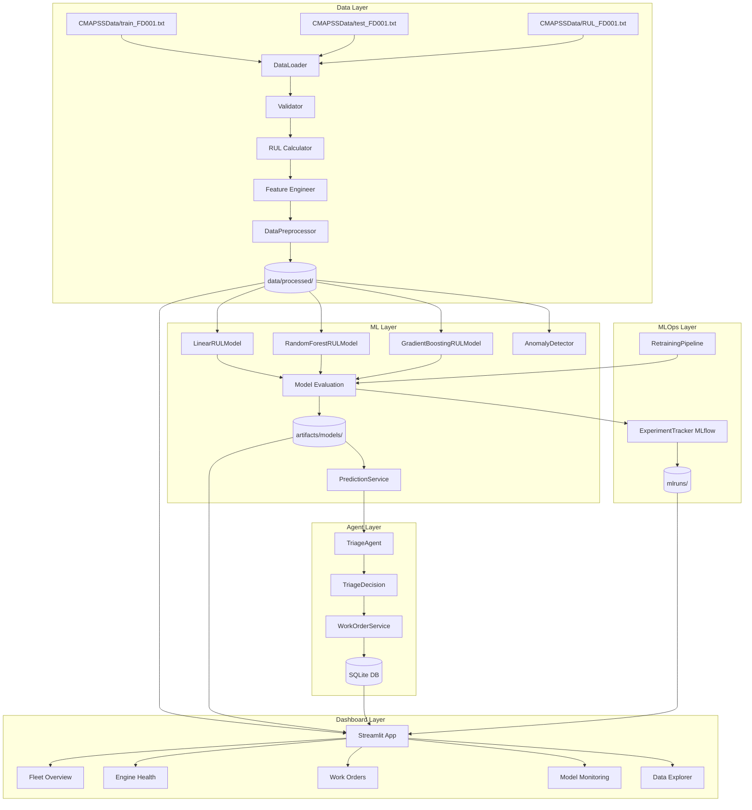
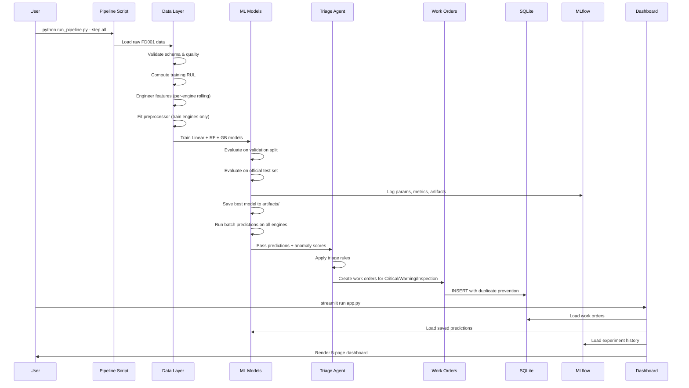

# Self-Healing Machines: ML-Powered Predictive Maintenance
## Round 1 Design Document

---

## 1. Problem Statement and Objectives

### Problem Statement
Unplanned machine failures in industrial operations cause significant downtime, safety risks, and maintenance costs. Traditional scheduled maintenance is either too conservative (replacing healthy components) or too reactive (responding only after failure). A data-driven predictive maintenance system can identify failure risk early, enabling maintenance teams to act before failures occur.

### Project Objectives
1. Build a machine learning system that predicts **Remaining Useful Life (RUL)** of aircraft turbofan engines in operating cycles.
2. Detect **sensor anomalies** that may indicate developing faults before they become critical.
3. Apply **rule-based triage** to classify engine health and recommend maintenance actions.
4. Automatically generate **maintenance work orders** with priority and audit trail.
5. Track **model experiments** and support safe model retraining and promotion.
6. Provide a **real-time monitoring dashboard** for fleet health oversight.

### Why This Matters
- **Safety**: Early warning reduces risk of catastrophic failure.
- **Cost**: Condition-based maintenance reduces unnecessary part replacements.
- **Transparency**: Rule-based triage (not a black-box AI) means engineers understand every recommendation.
- **Auditability**: SQLite work orders and MLflow tracking create complete decision records.

---

## 2. Dataset Selection and Justification

### Selected Dataset: NASA CMAPSS FD001
**Full name**: Commercial Modular Aero-Propulsion System Simulation (CMAPSS)  
**Source**: NASA Ames Prognostics Center of Excellence  
**Reference**: Saxena et al., "Damage Propagation Modeling for Aircraft Engine Run-to-Failure Simulation", PHM08, Denver CO, Oct 2008.

### Dataset Characteristics (FD001)
| Property | Value |
|---|---|
| Training engines | 100 |
| Test engines | 100 |
| Operating conditions | 1 (Sea Level) |
| Fault modes | 1 (HPC Degradation) |
| Columns | 26 (engine ID, cycle, 3 op settings, 21 sensors) |
| Training cycles | ~20,000+ rows |

### Why FD001?
- **Single operating condition**: Cleaner signal, more suitable for baseline implementation.
- **Single fault mode**: Well-defined degradation pattern, interpretable results.
- **Official RUL labels**: `RUL_FD001.txt` provides 100 final-RUL values for objective evaluation.
- **Community benchmark**: Well-studied dataset with published baselines for comparison.
- **No external download required**: Dataset is pre-provided in the project workspace.

### RUL Computation
- **Training**: `RUL = max_cycle_for_engine - current_cycle` (runs to failure)
- **Test**: `RUL = (max_cycle_in_test - current_cycle) + official_final_RUL`
- **Optional cap**: `RUL_target = min(RUL, 125)` — prevents very long-horizon predictions from dominating training; configurable.

---

## 3. Data Engineering Plan

### 3.1 Raw Data Loading
- Space-separated text files, no header row
- 26 columns assigned descriptive names (engine_id, cycle, op_setting_1–3, sensor_1–21)
- Handles trailing whitespace columns robustly

### 3.2 Data Validation
| Check | What It Catches |
|---|---|
| Column count | Malformed files |
| Numeric types | Corrupted values |
| Missing values | NaN in sensor readings |
| Infinite values | Sensor overflow |
| Duplicate rows | Repeated observations |
| Cycle monotonicity | Out-of-order or missing cycles |
| Engine ID coverage | RUL label alignment |

### 3.3 Feature Engineering
**Selected sensors** (14 of 21 — sensors with non-trivial variance in FD001):
sensors 2, 3, 4, 7, 8, 9, 11, 12, 13, 14, 15, 17, 20, 21

**Features per sensor**:
- Raw reading at current cycle
- Rolling mean (windows: 5, 10, 20 cycles)
- Rolling standard deviation (windows: 5, 10, 20 cycles)
- Trend (rolling diff over 5 cycles)

**Operating settings**: op_setting_1, op_setting_2 included as features.

**Key constraint**: Rolling windows computed **per-engine** in chronological order. No cross-engine leakage.

### 3.4 Train/Validation Split
- Split by **engine ID** (not rows): 80% of engines → training, 20% → validation
- Prevents data leakage from same engine appearing in both sets
- Imputer and scaler fitted on training engines only

### 3.5 Preprocessing Persistence
- Fitted `StandardScaler` and `SimpleImputer` saved via joblib
- Feature column list saved as JSON
- Applied identically to validation, test, and dashboard inference

---

## 4. ML Algorithm Selection and Reasoning

### 4.1 Model Selection

| Model | Reason | Trade-off |
|---|---|---|
| Linear Regression | Interpretable baseline; establishes minimum performance | Cannot capture non-linear degradation patterns |
| Random Forest Regressor | Handles non-linearity, feature interactions, robust to outliers | Less interpretable than linear; requires tuning |
| Gradient Boosting Regressor | Often top performer on tabular regression | Slower to train, more hyperparameters |

### 4.2 RUL Cap
- Cap at 125 cycles: When RUL is very high (engine just started), exact RUL is less important for maintenance decisions.
- Without cap: Model spends too much capacity on early-lifecycle accuracy where maintenance decisions don't change.
- Both capped and uncapped results are evaluated and compared.

### 4.3 Evaluation Metrics

**MAE (Mean Absolute Error)**: Average absolute prediction error in cycles. Lower is better.

**RMSE (Root Mean Squared Error)**: Penalizes large errors more than MAE. Lower is better.

**NASA Asymmetric Score**:
```
d_i = predicted_RUL_i - true_RUL_i
s_i = exp(-d_i / 13) - 1   if d_i < 0  (early prediction — penalized less)
s_i = exp(d_i / 10) - 1    if d_i >= 0 (late prediction — penalized more)
Score = sum(s_i)
```
Lower score is better. Late predictions (underestimating failure urgency) are penalized more heavily.

### 4.4 Anomaly Detection: Isolation Forest
- Unsupervised: Does not require anomaly labels
- Fits on training data; calibrates threshold using training/validation scores
- Score interpretation: More negative = more anomalous (sklearn decision_function convention)
- Threshold: set at 10th percentile of training scores by default (configurable)
- Output: anomaly score + binary flag; does NOT claim to diagnose fault type

---

## 5. System Architecture



---

## 6. End-to-End Workflow Diagram



---

## 7. Triage Decision Table

| Condition | Severity | Recommended Action | Triggered Rule |
|---|---|---|---|
| Invalid input (NaN/None/negative cycle) | DataQuality | Reject observation — data quality issue | RULE_INVALID_INPUT |
| Predicted RUL ≤ 15 cycles | Critical | Schedule emergency maintenance immediately | RULE_CRITICAL_RUL |
| 15 < Predicted RUL ≤ 40 cycles | Warning | Schedule planned maintenance within 2 maintenance windows | RULE_WARNING_RUL |
| Predicted RUL > 40, anomaly_score < threshold | InspectionReview | Perform targeted sensor inspection and manual review | RULE_ANOMALY_OVERRIDE |
| Predicted RUL > 40, no anomaly | Normal | Continue standard monitoring | RULE_NORMAL |

**Note**: Thresholds (15, 40 cycles, anomaly threshold) are demonstration policies configurable in `config/settings.yaml`. They are not validated real-world maintenance limits.

---

## 8. MLOps and Retraining Plan

### 8.1 MLflow Experiment Tracking
Every training run logs:
- Experiment: `self_healing_machines`
- Parameters: model type, hyperparameters, feature config, RUL cap, dataset version
- Metrics: MAE, RMSE, NASA score (validation + test)
- Artifacts: model file, preprocessor, feature list, metadata JSON

### 8.2 Candidate Model Promotion Workflow
```
1. Load approved training dataset (FD001)
2. Validate data integrity
3. Rebuild features from scratch
4. Engine-wise train/val split (same seed)
5. Train candidate model (Random Forest)
6. Evaluate candidate on validation split → candidate_mae
7. Load active model (if exists)
8. Evaluate active model on SAME validation split → active_mae
9. If candidate_mae < active_mae × (1 - min_improvement_fraction):
      Backup active model → artifacts/models/backup_{timestamp}/
      Promote candidate → active
      Write artifacts/models/active_model.txt
      Log promotion event to MLflow
   Else:
      Log rejection event to MLflow
      Active model unchanged
10. Return promotion decision + metrics
```

### 8.3 Model Versioning
- Models saved under `artifacts/models/{run_id}/`
- `active_model.txt` points to current active model
- Backup copies preserved for rollback
- Full audit trail in MLflow

---

## 9. Testing and Evaluation Plan

### 9.1 Unit Tests
| Test Suite | Coverage |
|---|---|
| `test_data_pipeline.py` | Column parsing, RUL calculations, engine-wise splits, feature rolling |
| `test_triage_agent.py` | All severity branches, boundaries, invalid inputs, batch evaluation |
| `test_work_orders.py` | CRUD, duplicate prevention, status transitions, filters, audit trail |
| `test_models.py` | Metric calculations, artifact loading, NASA score formula |

### 9.2 Integration Test
`run_pipeline.py --step all` on FD001 constitutes the end-to-end integration test.

### 9.3 Acceptance Criteria
- All unit tests pass (or failures explicitly reported with root cause)
- FD001 training RUL computed correctly (last cycle = 0 for all engines)
- Test RUL alignment: engine 1 final RUL = 112 (per `RUL_FD001.txt`)
- No engine appears in both train and validation split
- Model predictions load from artifacts (not retrained) on dashboard start
- Work order for same engine+cycle+severity created only once
- MLflow run visible at `localhost:5000` or local tracking store

---

## 10. Risks, Assumptions and Limitations

### Risks
| Risk | Mitigation |
|---|---|
| Model underperforms on test set | Compare multiple models; report actual metrics |
| Rolling feature NaNs at engine start | Use min_periods=1 in rolling operations |
| SQLite concurrency under high dashboard refresh | Single-user demo; add WAL mode for multi-user |
| MLflow tracking server unavailable | Use local file-based tracking (no server needed) |
| Sensor selection impacts model performance | Selected sensors based on variance analysis; configurable |

### Assumptions
- FD001 dataset is static; no live sensor feed is implemented.
- "Cycles" are the unit of RUL; no calendar time conversion.
- Operating settings are stable within FD001 (one condition).
- The last cycle in training is the failure cycle (RUL = 0).
- The triage thresholds (15, 40 cycles) are demonstration values, not validated limits.

### Limitations
- No real-time sensor integration (simulation mode only).
- Anomaly detection has no ground-truth labels; precision/recall cannot be reported.
- FD001 is a simulation dataset; real engines may have different degradation patterns.
- Dashboard is single-user (SQLite limitation for concurrent writes).
- Retraining uses the same static FD001 data; true online learning would require new sensor data.

---

*Document prepared for Self-Healing Machines project — College Case Study, Round 1 Design Presentation.*
